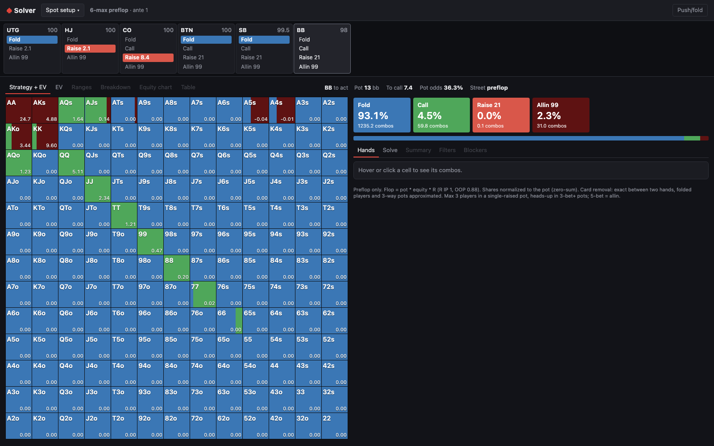

<div align="center">


# cfr-poker-lab

### A local poker study tool with CFR solvers and a strategy browser.

[](https://nodejs.org) [](https://www.rust-lang.org) [](https://developer.mozilla.org/docs/Web/JavaScript)

[](https://github.com/mortennordbye/cfr-poker-lab/actions/workflows/ci.yml) [](https://securityscorecards.dev/viewer/?uri=github.com/mortennordbye/cfr-poker-lab)

[](LICENSE) [](https://github.com/mortennordbye/cfr-poker-lab/commits/main) [](https://github.com/mortennordbye/cfr-poker-lab/stargazers)

This project solves No-Limit Hold'em spots on your own computer with Counterfactual Regret Minimization (CFR)
and lets you click through the solved game tree: preflop, flop, turn and river.
It started as an experiment to learn how poker solvers work.



</div>

---

## Overview

| Engine | Game | Method | Typical solve time (M4 Pro) |
| ------ | ---- | ------ | --------------------------- |
| `hu-preflop` | Heads-up preflop (SB vs BB): fold, limp, open, 3-bet, 4-bet, all-in | CFR+ over 169 hand classes | about 2 s at 100bb |
| `sixmax-preflop` | 6-max preflop (UTG to BB), cash or MTT with BB ante | Vector CFR+ over 169 classes, 4 threads | 14 to 27 s, then cached |
| `postflop` | Heads-up flop, turn and river from given ranges | Rust, wraps [b-inary/postflop-solver](https://github.com/b-inary/postflop-solver) (discounted CFR) | flop about 35 s, turn about 3 s |
| `postflop-js` | Same as `postflop`, smaller trees | Discounted CFR in plain JavaScript | flop 70 to 95 s |
| `pushfold` | Heads-up push/fold | CFR+ | under 1 s |

The preflop engines do not play postflop. They value a flop with *equity realization*: each hand gets a share
of the pot based on its equity and a realization factor R. R starts flat (1.0 in position, 0.88 out of position)
and can be **calibrated per hand** from postflop solves. Each "Solve flop" you run from a heads-up preflop spot
saves a sample, and the next preflop solve uses all samples for that spot.

| UI part | What it shows |
| ------- | ------------- |
| Action bar | One column per decision; click a column to go back. Board cards per street. |
| Strategy grid | 13x13 hands, each cell split by action frequency, with the EV of the hand (fold = 0). |
| Right panel | Action summary (% and combos), pot odds, per-combo frequencies and EV, solve stats and calibration status. |
| Spot setup | Engine and parameters: stacks, ante, bet sizes, realization, iterations. |

All engines follow one node format and API, described in [CONTRACT.md](CONTRACT.md).

---

## Getting Started

Requirements: Node.js 26 (no npm packages) and a stable Rust toolchain for the `postflop` engine.

1. **Clone**: `git clone https://github.com/mortennordbye/cfr-poker-lab.git && cd cfr-poker-lab`
2. **Run**: `node server.js`, then open <http://localhost:8787>
3. **First flop solve**: the `postflop` engine builds its Rust binary with `cargo build --release` on first use
   (needs network access once). Without Rust, start with `SKIP_ENGINES=postflop node server.js` to use the
   JavaScript engine instead.

Tests (each prints its checks and exits non-zero on failure):

```sh
node engines/hu-preflop/test.js
node engines/sixmax-preflop/test.js
node engines/postflop-js/test.js
node engines/postflop/test.js      # needs Rust
```

Fill the calibration samples for one heads-up spot in one batch run (takes hours):

```sh
node tools/calibrate-hu.js --stack 100 --sbOpen 2.25 --limp true
```


---

## Repository structure

```text
cfr-poker-lab/
├── server.js            # HTTP server: engine registry, solve jobs, static UI
├── idle.js              # optional: fills calibration samples when the tool is idle
├── CONTRACT.md          # node format and API shared by all engines and the UI
├── engines/
│   ├── hu-preflop/      # heads-up preflop CFR+
│   ├── sixmax-preflop/  # 6-max preflop CFR+
│   ├── postflop/        # Rust postflop engine (rs/ = cargo project)
│   ├── postflop-js/     # JavaScript postflop engine (fallback, test reference)
│   └── pushfold/        # heads-up push/fold
├── lib/                 # hand evaluator, equity table, flop subset, realization samples
├── public/              # browser UI
├── tools/               # batch calibration
├── docs/screenshots/
└── .github/workflows/   # CI and security pipelines
```

---

## Workflows

| Workflow | Trigger | Purpose |
| -------- | ------- | ------- |
| CI | push, PR | engine test suites (Node) and the Rust build + postflop tests |
| Dependency Review | PR | block known-vulnerable dependency changes |
| Scorecard | push, weekly | OpenSSF supply-chain grade |

---

## Notes

- **Not affiliated** with any commercial poker solver or training site. Product names belong to their owners.
- **For study only.** Many poker sites forbid real-time assistance tools during play. Check the rules of the site you play on.
- **Results are approximations.** Preflop trees use one size per raise level and model postflop play with equity realization;
  postflop trees use a limited set of bet sizes.
- **License:** AGPL-3.0, see [LICENSE](LICENSE). The `postflop` engine links
  [postflop-solver](https://github.com/b-inary/postflop-solver) by Wataru Inariba (AGPL-3.0-or-later).

---

<div align="center">

### ⭐ Star this repo if you find it useful ⭐

<a href="https://www.star-history.com/#mortennordbye/cfr-poker-lab&Date">
  <picture>
    <source media="(prefers-color-scheme: dark)" srcset="https://api.star-history.com/svg?repos=mortennordbye/cfr-poker-lab&type=Date&theme=dark" />
    <source media="(prefers-color-scheme: light)" srcset="https://api.star-history.com/svg?repos=mortennordbye/cfr-poker-lab&type=Date" />
    
  </picture>
</a>

Made by [Morten Nordbye](https://github.com/mortennordbye)

</div>
