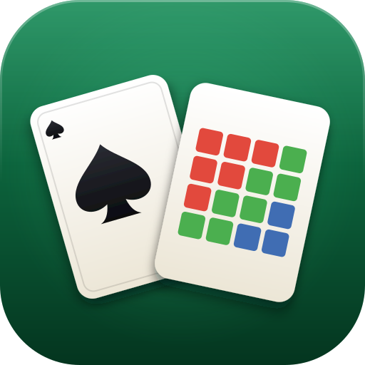
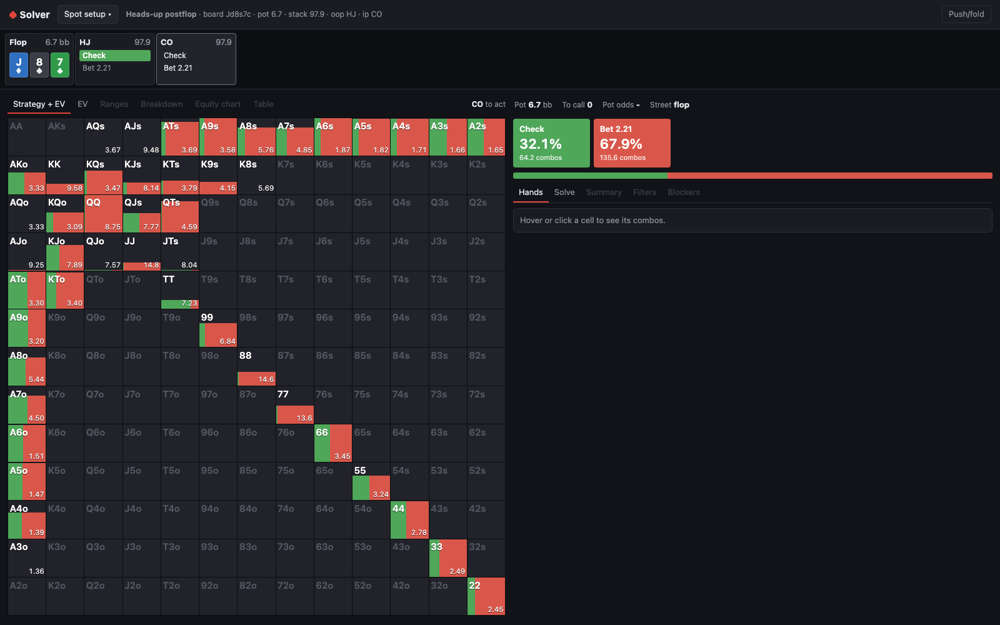

<div align="center">



# cfr-poker-lab

### A local poker study tool with CFR solvers and a strategy browser.

[](https://nodejs.org) [](https://www.rust-lang.org) [](https://developer.mozilla.org/docs/Web/JavaScript)

[](https://github.com/mortennordbye/cfr-poker-lab/actions/workflows/ci.yml) [](https://securityscorecards.dev/viewer/?uri=github.com/mortennordbye/cfr-poker-lab)

[](LICENSE) [](https://github.com/mortennordbye/cfr-poker-lab/commits/main) [](https://github.com/mortennordbye/cfr-poker-lab/stargazers)

This project solves No-Limit Hold'em spots on your own computer with Counterfactual Regret Minimization (CFR)
and lets you click through the solved game tree: preflop, flop, turn and river.
It started as an experiment to learn how poker solvers work.

**[Try it in the browser](https://mortennordbye.github.io/cfr-poker-lab/)**: no install, but slower (see [Browser mode](#browser-mode)).


</div>

---

## Overview

| Engine | Game | Method | Typical solve time (M4 Pro) |
| ------ | ---- | ------ | --------------------------- |
| `hu-preflop` | Heads-up preflop (SB vs BB): fold, limp, open, 3-bet, 4-bet, all-in | CFR+ over 169 hand classes | about 2 s at 100bb |
| `sixmax-preflop` | 6-max preflop (UTG to BB), cash or MTT with BB ante | Vector CFR+ over 169 classes, 4 threads | 14 to 27 s, then cached |
| `postflop` | Heads-up flop, turn and river from given ranges | Rust, wraps [b-inary/postflop-solver](https://github.com/b-inary/postflop-solver) (discounted CFR) | flop about 35 s, turn about 3 s |
| `postflop-js` | Same as `postflop`, smaller trees | Discounted CFR in plain JavaScript | flop 70 to 95 s |
| `pushfold` | Heads-up push/fold | CFR+ | under 1 s |

The preflop engines do not play postflop. They value a flop with *equity realization*: each hand gets a share
of the pot based on its equity and a realization factor R. R starts flat (1.0 in position, 0.88 out of position)
and can be **calibrated per hand** from postflop solves. Each "Solve flop" you run from a heads-up preflop spot
saves a sample, and the next preflop solve uses all samples for that spot.

| UI part | What it shows |
| ------- | ------------- |
| Action bar | One column per decision; click a column to go back. Board cards per street. |
| Strategy grid | 13x13 hands, each cell split by action frequency, with the EV of the hand (fold = 0). |
| Right panel | Action summary (% and combos), pot odds, per-combo frequencies and EV, solve stats and calibration status. |
| Spot setup | Engine and parameters: stacks, ante, bet sizes, realization, iterations. |

All engines follow one node format and API, described in [CONTRACT.md](CONTRACT.md).

---

## Getting Started

Requirements: [Docker](https://docs.docker.com/get-docker/) and [just](https://github.com/casey/just).
The image contains the Node.js app and the prebuilt Rust engine, so you do not need Node or Rust on your computer.

1. **Clone**: `git clone https://github.com/mortennordbye/cfr-poker-lab.git && cd cfr-poker-lab`
2. **Run**: `just up` (builds the image), or `just pull` (uses the published image), then open <http://localhost:8787>
3. **Stop**: `just down`. Solves and calibration samples stay in the `cfr_cache` volume.

Without cloning, run the published image directly (amd64 and arm64):

```sh
docker run -d --name cfr-poker-lab -p 127.0.0.1:8787:8787 -v cfr_cache:/app/cache ghcr.io/mortennordbye/cfr-poker-lab:latest
```

| Command | What it does |
| ------- | ------------ |
| `just up` | build the image and start the app |
| `just pull` | start with the image from ghcr.io |
| `just down` / `just restart` / `just logs` | stop, restart, follow the logs |
| `just test` | run every engine test suite inside the image |
| `just dev` | run without Docker (needs Node.js 26, and Rust for the `postflop` engine) |

The port is bound to `127.0.0.1` only: the app has no login, so do not expose it to a network.
The container is limited to 6 GB of RAM; one open flop solve uses about 1.6 GB.

Without Docker, `node server.js` also works. The `postflop` engine then builds its Rust binary with
`cargo build --release` on first use; `SKIP_ENGINES=postflop node server.js` uses the JavaScript engine instead.

### Browser mode

The same UI also runs as a static site on GitHub Pages: <https://mortennordbye.github.io/cfr-poker-lab/>.
The solves run on your computer, inside the page, in Web Workers. The Rust `postflop` engine runs as WebAssembly,
with the same default trees as local mode. A banner in the page says so.

- **Slower**: a flop solve from a heads-up preflop spot takes about 1.5 minutes for a raised pot and 2.5 minutes for a
  limped pot (local: about 1 to 1.5 minutes); a turn solve takes about 4 seconds. Preflop solves take about as long as locally.
- **One thread without cross-origin isolation**: the page gets it from a service worker. If the browser does not allow
  it, the engine uses one thread: same results, but a flop takes about 10 minutes and stops at the 10-minute limit.
- **Memory**: WebAssembly has at most 4 GB. Trees above 3.6 GB stop with "out of memory: try a smaller tree".
  The default flop trees need about 2.9 GB. The page keeps one finished postflop solve.
- **Not available**: "Fill calibration when idle". `postflop-js` stays as a fallback if the WebAssembly engine cannot load.
- Solve caches and calibration samples stay in the browser (IndexedDB).

Build the site locally with `tools/build-wasm.sh` (Rust nightly for threads, see
[engines/postflop/README.md](engines/postflop/README.md#browser-mode-webassembly)), then `node tools/build-web.js` (writes `dist/`).

Fill the calibration samples for one heads-up spot in one batch run (takes hours):

```sh
node tools/calibrate-hu.js --stack 100 --sbOpen 2.25 --limp true
```



### Flop reports

A flop report solves one flop spot on 25, 49 or 95 representative flops and shows how the strategy changes with
the board: the OOP strategy at the flop root, the IP strategy after a check, EV and equity, per flop and by
texture group. Local mode only (`node server.js` or Docker), one solve at a time; a stopped report continues
where it was. A report from a heads-up preflop terminal also saves calibration samples.

```bash
node tools/flop-report.js --list                                   # flop terminals of the heads-up 100bb spot
node tools/flop-report.js --terminal 'SB:Raise 2.5/BB:Call' --flops 25
```

API: `POST /api/report`, `GET /api/report/:id`, `GET /api/reports` (see [CONTRACT.md](CONTRACT.md#flop-reports)).
Measured on an M-series Mac, 4 threads on the efficiency cores at low priority, target 1% pot, 300 s limit per
flop: the 25-flop report of the heads-up 100bb raised pot took 130 min of solve time (median 311 s per flop, 228 to
450 s). Most flops stopped at the time limit: median exploitability 1.4% pot, 8 of 25 flops at about 1%, worst 8.2%.

### Precomputed data

Big batch runs (flop reports, 6-max calibration samples) run on GitHub runners, not on your computer. The
**Precompute** workflow (Actions tab, "Run workflow") splits the missing work over up to 20 runners, joins the
results and stores them in the release `data` (`cfr-data.tar.gz` + `manifest.json`). A run only solves what the
data does not have yet; `force` solves everything again.

| Command | What it does |
| ------- | ------------ |
| `just data` | download the data into `cache/` (files that exist stay as they are) |
| `just data-docker` | the same into the `cfr_cache` volume of the container |

The live page shows the precomputed flop reports read-only. Spots: `tools/presets.json`.
Details: [CONTRACT.md](CONTRACT.md#precomputed-data).

```sh
gh workflow run precompute.yml -f job=flop-report -f preset=hu-100bb-srp -f flops=95
```

---

## Repository structure

```text
cfr-poker-lab/
├── server.js            # HTTP server: engine registry, solve jobs, static UI
├── idle.js              # optional: fills calibration samples when the tool is idle
├── CONTRACT.md          # node format and API shared by all engines and the UI
├── engines/
│   ├── hu-preflop/      # heads-up preflop CFR+
│   ├── sixmax-preflop/  # 6-max preflop CFR+
│   ├── postflop/        # Rust postflop engine (rs/ = cargo project)
│   ├── postflop-js/     # JavaScript postflop engine (fallback, test reference)
│   └── pushfold/        # heads-up push/fold
├── lib/                 # hand evaluator, equity table, flop subset, realization samples
├── public/              # browser UI (browser/ = in-page API and adapters for the static site)
├── tools/               # batch calibration, static site build (build-web.js)
├── Dockerfile           # two stages: Rust build, then Node runtime
├── docker-compose.yml   # loopback port, cache volume, resource limits
├── justfile             # up, down, logs, test, dev
├── docs/screenshots/
└── .github/workflows/   # CI and security pipelines
```

---

## Workflows

| Workflow | Trigger | Purpose |
| -------- | ------- | ------- |
| CI | push, PR | engine test suites (Node), Rust build + postflop tests, WebAssembly build, then a multi-arch image build; on `main` the image is published to `ghcr.io/mortennordbye/cfr-poker-lab` |
| Container Scan | push, weekly | Trivy image scan, results in the Security tab |
| Dependency Review | PR | block known-vulnerable dependency changes |
| Scorecard | push, weekly | OpenSSF supply-chain grade |
| Pages | push to `main`, after Precompute | build the WebAssembly engine and the static site (browser mode) with the precomputed reports, deploy it to GitHub Pages |
| Precompute | manual; PR that changes it (smoke test) | batch solves on up to 20 runners, results in the release `data` |

---

## Notes

- **Not affiliated** with any commercial poker solver or training site. Product names belong to their owners.
- **For study only.** Many poker sites forbid real-time assistance tools during play. Check the rules of the site you play on.
- **Results are approximations.** Preflop trees use one size per raise level and model postflop play with equity realization;
  postflop trees use a limited set of bet sizes.
- **License:** AGPL-3.0, see [LICENSE](LICENSE). The `postflop` engine links
  [postflop-solver](https://github.com/b-inary/postflop-solver) by Wataru Inariba (AGPL-3.0-or-later).

---

<div align="center">

### ⭐ Star this repo if you find it useful ⭐

<a href="https://www.star-history.com/#mortennordbye/cfr-poker-lab&Date">
  <picture>
    <source media="(prefers-color-scheme: dark)" srcset="https://api.star-history.com/svg?repos=mortennordbye/cfr-poker-lab&type=Date&theme=dark" />
    <source media="(prefers-color-scheme: light)" srcset="https://api.star-history.com/svg?repos=mortennordbye/cfr-poker-lab&type=Date" />
    
  </picture>
</a>

Made by [Morten Nordbye](https://github.com/mortennordbye)

</div>
